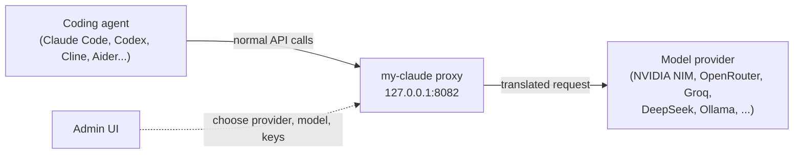

# my-claude

**Use your favorite AI coding agent with any model you can reach.**

`my-claude` is a fork of [Free Claude Code](https://github.com/Alishahryar1/free-claude-code). It runs a small local proxy that sits between a coding agent (Claude Code, Codex, Cline, Aider and others) and a model provider (free tiers, paid APIs, or models on your own machine). The agent thinks it is talking to its usual service. The proxy translates the request and sends it wherever you choose.

This fork focuses on one thing: **an install that survives slow and restricted internet connections.**

[](LICENSE)
[](https://www.python.org/downloads/)
[](https://github.com/Alishahryar1/free-claude-code)

> Independent open-source project. Not affiliated with or endorsed by Anthropic. Claude and Claude Code are trademarks of Anthropic.

---

## At a glance

| | |
| --- | --- |
| **What it is** | A local proxy at `127.0.0.1:8082` plus an installer and an Admin web UI |
| **Agents** | Claude Code, Codex, Pi, OpenCode, Cline, Hermes, DeepSeek Harness, Grok Build, Muse Code, Aider, VS Code Chat (Antigravity CLI is opt-in) |
| **Providers** | 60+ (free, paid, subscription, local). Pick one in the Admin UI |
| **APIs it speaks** | Anthropic Messages, OpenAI Chat Completions, OpenAI Responses, Gemini |
| **Platforms** | Windows, macOS, Linux |

## How it works



You pick the provider and model once in the Admin UI. Every agent you launch through an `fcc-*` command then uses that choice.

---

## Get started in four steps

### 1. Install

Windows PowerShell:

```powershell
& ([scriptblock]::Create((irm "https://raw.githubusercontent.com/Mositat7/my-claude/main/free-claude-code-main/scripts/install.ps1")))
```

macOS / Linux:

```bash
curl -fsSL "https://raw.githubusercontent.com/Mositat7/my-claude/main/free-claude-code-main/scripts/install.sh" | sh
```

Pick at least one coding agent when asked. Optionally turn on RTK + Headroom to cut token usage.

> On a slow or filtered connection? Read [Slow or restricted networks](#slow-or-restricted-networks) **first**, then run the installer.

### 2. Start the server

- **Windows / macOS:** open **Free Claude Code** from the Start menu, desktop or Applications folder.
- **Linux:** run `fcc-server` and leave the terminal open.

The Admin UI opens automatically.

### 3. Pick a provider and a model

In the Admin UI, open **Providers**, add an API key for the provider you want, then choose a model under **Model Config** and click **Apply**.

A few starting points:

| Provider | Setting | Notes |
| --- | --- | --- |
| NVIDIA NIM | `NVIDIA_NIM_API_KEY` | Default in the quick start flow |
| OpenRouter | `OPENROUTER_API_KEY` | Has free-tier models, e.g. `open_router/openrouter/free` |
| Groq | `GROQ_API_KEY` | Fast hosted open models |
| DeepSeek | `DEEPSEEK_API_KEY` | Official DeepSeek API |
| Ollama / LM Studio / llama.cpp | `*_BASE_URL` | Runs on your machine, works offline once the model is downloaded |

The full provider list lives in the Admin UI and in the [upstream README](https://github.com/Alishahryar1/free-claude-code#choose-a-provider). Free-tier limits belong to each provider and can change.

### 4. Launch an agent

| Agent | Command |
| --- | --- |
| Claude Code | `fcc-claude` |
| Codex | `fcc-codex` |
| Cline | `fcc-cline` |
| Aider | `fcc-aider` |
| Pi | `fcc-pi` |
| OpenCode | `fcc-opencode` |
| Hermes | `fcc-hermes` |
| DeepSeek Harness | `fcc-dsh` |
| Grok Build | `fcc-grok` |
| Muse Code | `fcc-muse` |

The launcher starts the server for you if it is not already running.

---

## What this fork changes

| Change | Reason |
| --- | --- |
| Antigravity CLI is **not offered** by the installer by default | Its download URL answers `403` in some regions, which aborts the whole install |
| Local voice (`--voice-local`, `--torch-backend`) is **hidden from `--help`** | It downloads PyTorch, a very large file that often times out on slow links |
| New switch `-ShowAdvanced` (PowerShell) / `--show-advanced` (sh), or `FCC_SHOW_ADVANCED=1` | Brings those options back whenever you want them |

Nothing was removed. `-VoiceLocal` and `--voice-local` still work when you pass them yourself. The only files modified are `scripts/install.ps1`, `scripts/install.sh` and the installer tests.

---

## Slow or restricted networks

Most "I need a VPN" failures during install are really **timeouts on large downloads** (uv and Python builds come from GitHub, packages from PyPI), not blocked sites. Try this first.

**Windows PowerShell** (applies to the current window only):

```powershell
$env:UV_HTTP_TIMEOUT = "600"
$env:UV_CONCURRENT_DOWNLOADS = "2"
$env:UV_DEFAULT_INDEX = "https://mirror-pypi.runflare.com/simple"
uv self update
uv python install 3.14
```

**macOS / Linux:**

```bash
export UV_HTTP_TIMEOUT=600
export UV_CONCURRENT_DOWNLOADS=2
export UV_DEFAULT_INDEX="https://mirror-pypi.runflare.com/simple"
uv self update
uv python install 3.14
```

Then run the installer as usual.

Good to know:

- Mirrors change over time. Check one responds (`curl -I <mirror-url>`) before relying on it.
- A mirror only speeds up Python packages. At runtime the proxy still contacts your chosen model provider directly, and some providers may not be reachable from every country.
- If the Python download keeps failing, grab a build from the [python-build-standalone releases](https://github.com/astral-sh/python-build-standalone/releases) and let `uv` use the local copy.
- Running a local model with Ollama, LM Studio or llama.cpp avoids provider reachability problems entirely.

---

## Troubleshooting

| Symptom | Likely cause | What to try |
| --- | --- | --- |
| `getaddrinfo failed` / `Errno 11001` | DNS cannot resolve the provider hostname, or the base URL has a typo | Run `nslookup pypi.org`. If that fails, change DNS (for example `1.1.1.1` and `8.8.8.8`) and run `ipconfig /flushdns`. If it works, re-check the provider base URL |
| `HTTP 504` when listing models | Wrong base URL, or the provider is slow or unreachable from your network | Test it directly: `curl -i --max-time 30 -H "Authorization: Bearer KEY" https://BASE_URL/models`. `401` means a bad key, `404` a wrong URL |
| Installer fails on Antigravity with `403` | Region block on its install URL | Use this fork's default (Antigravity off), or skip it |
| Install times out during uv / Python download | Slow transfers from GitHub | Use the timeout and mirror settings above |
| uv does not recognise the Python version | Old uv | `uv self update` |
| Agent says it cannot reach `127.0.0.1:8082` | The proxy is not running | Start the app, or run `fcc-server` |
| Something else is broken after install | | Run `fcc-doctor` and include its output in your issue |

---

## FAQ

**Is this free?**
The software is free and open source. Whether a model is free depends on the provider and its current free tier.

**Do I need a VPN?**
Not for installing, in most cases (see above). Whether you need one at runtime depends on which provider you choose and where you are.

**Can I run it fully offline?**
Yes, with a local provider (Ollama, LM Studio or llama.cpp) once the model has been downloaded.

**How do I update or remove it?**
Update with `fcc-update`. To uninstall, run `scripts/uninstall.ps1` (Windows) or `scripts/uninstall.sh` (macOS/Linux). Uninstalling removes FCC and `~/.fcc/`, and keeps uv, Python and your coding agents.

**Where do I report bugs?**
Problems with the install changes in this fork: [this repo's issues](https://github.com/Mositat7/my-claude/issues). Everything else: the [upstream project](https://github.com/Alishahryar1/free-claude-code/issues).

---

## Advanced options

Bring back the hidden installer options:

```powershell
# Windows
& ([scriptblock]::Create((irm "https://raw.githubusercontent.com/Mositat7/my-claude/main/free-claude-code-main/scripts/install.ps1"))) -ShowAdvanced
```

```bash
# macOS / Linux
curl -fsSL "https://raw.githubusercontent.com/Mositat7/my-claude/main/free-claude-code-main/scripts/install.sh" | sh -s -- --show-advanced
```

Local Whisper voice transcription (needs PyTorch, large download):

```powershell
& ([scriptblock]::Create((irm "https://raw.githubusercontent.com/Mositat7/my-claude/main/free-claude-code-main/scripts/install.ps1"))) -VoiceLocal
```

```bash
curl -fsSL "https://raw.githubusercontent.com/Mositat7/my-claude/main/free-claude-code-main/scripts/install.sh" | sh -s -- --voice-local
```

Chat from your phone, editor integrations and direct API usage are configured in the Admin UI under **Messaging** and **Integrations**, and work as described in the upstream documentation.

---

## Credits and license

This project is built on [Free Claude Code](https://github.com/Alishahryar1/free-claude-code) by its original authors. Thank you to them and to every contributor upstream.

Licensed under the **GNU Affero General Public License v3.0 only** (`AGPL-3.0-only`). See [LICENSE](LICENSE). This fork changes the installer scripts and their tests; the original copyright notices remain with their authors.
